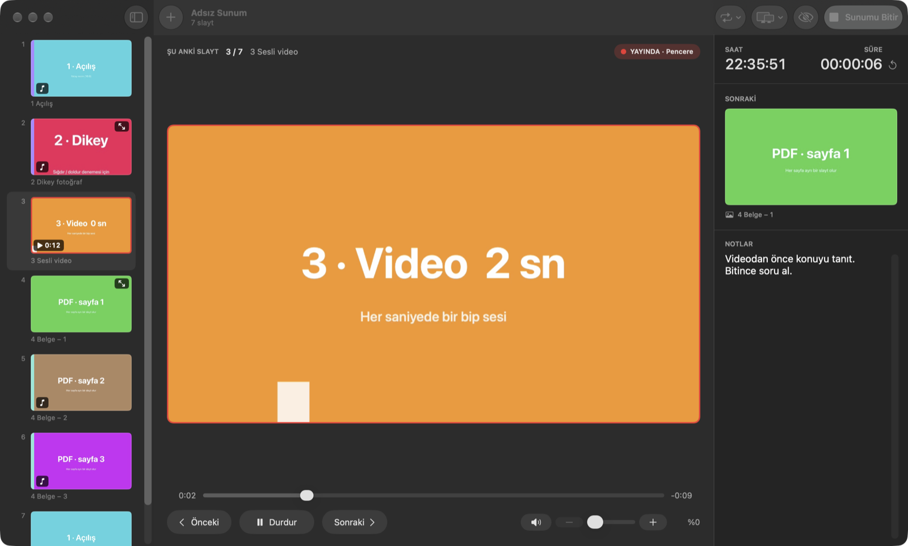
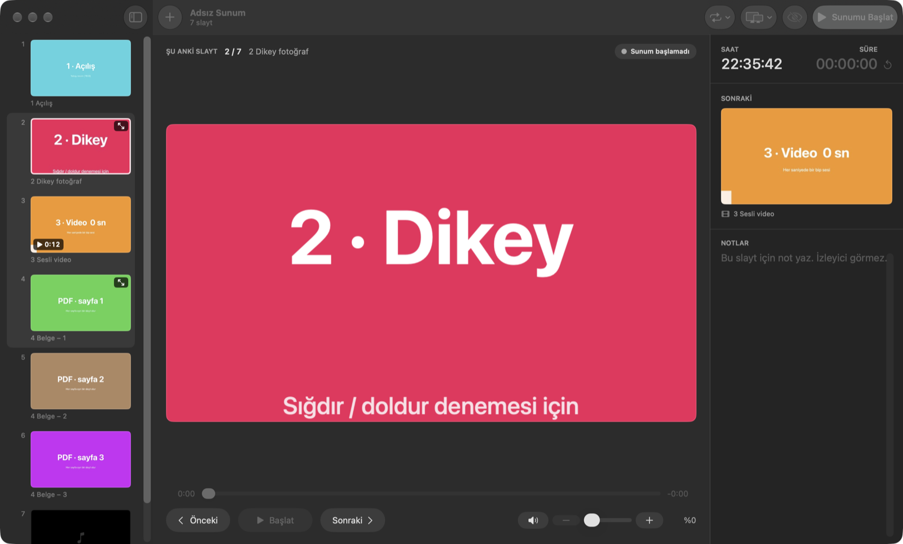

# Slidecast

Resim ve videolardan sunum hazırlayıp projeksiyonda gösteren bir macOS uygulaması. Bilgisayarın ekranı sunucu ekranı olarak kalır. Buradan slaytlar arasında geçebilir, videoyu durdurup başlatabilir, sesi ayarlayabilir, sonraki slaytı ve notlarınızı görebilirsiniz. İzleyici yalnızca tam ekran resmi ya da videoyu görür.



## Özellikler

- **Sürükle bırak:** resim, video, ses ve PDF dosyalarını pencereye bırakın. Her dosya bir slayt olur, PDF'te her sayfa ayrı bir slayt olur.
- **Sunucu ekranı:**
  - şu anki slayt
  - sonraki slaytın önizlemesi
  - video ilerleme çubuğu
  - ses ayarı
  - konuşmacı notları
  - saat ve geçen süre
- **Çıkış ekranı:**
  - ikinci ekran takılıysa sunum otomatik olarak oraya, tam ekran açılır; tek ekranda pencere olarak açılır
  - ekran karartma
- **Oynatma:**
  - video ve ses slaytları açılınca kendiliğinden başlar
  - slaytlar arasında yumuşak geçiş
  - her slayt için sığdır ya da ekranı doldur seçimi
- **Arka plan müziği:**
  - bir fotoğrafa ya da birden fazla fotoğrafa ortak müzik eklenebilir
  - ortak müzik o fotoğraflar boyunca kesilmeden çalar
- **Sunum akışı:** sunum sona gelince başa dönebilir, resim slaytları belirli bir süre sonra kendiliğinden ilerleyebilir.
- **Düzenleme:**
  - geri al / yinele
  - çoklu seçim
  - çoğaltma
  - yeniden adlandırma
  - sürükleyerek sıralama



## İndirme ve kurulum

1. [Releases](../../releases) sayfasından `Slidecast-<sürüm>-macOS.dmg` dosyasını indirin.
2. DMG'yi açın ve **Slidecast** simgesini **Applications** klasörüne sürükleyin.
3. Uygulama Apple'a kayıtlı bir geliştirici sertifikasıyla imzalanmadığı için ilk açılışta macOS uyarı verir. Bu durumda:
   - Uygulamayı bir kez açmayı deneyin ve uyarıyı kapatın.
   - **Sistem Ayarları › Gizlilik ve Güvenlik** bölümüne gidin, aşağıdaki **Yine de Aç** düğmesine basın.
   - Sonraki açılışlarda uyarı çıkmaz.

Gereksinim: macOS 14 (Sonoma) veya üstü. Apple Silicon ve Intel Mac'lerde çalışır.

## Klavye kısayolları

| Tuş | İşlev |
| --- | --- |
| → ↓ Enter Page Down | Sonraki slayt |
| ← ↑ Page Up | Önceki slayt |
| Home / End | İlk / son slayt |
| Boşluk | Video ve seste başlat / durdur, resimde sonraki slayt |
| + / − | Sesi yükselt / alçalt |
| M | Sesi kapat / aç |
| B | Ekranı karart |
| Esc | Sunumu bitir |
| ⌘ Enter | Sunumu başlat / bitir |
| ⌘ I | Dosya ekle |
| ⌘ D | Seçili slaytları çoğalt |
| ⇧ ⌘ F | Sığdır / ekranı doldur |
| ⇧ ⌘ M | Arka plan müziği seç |
| ⌘ Z / ⇧ ⌘ Z | Geri al / yinele |

## Sunum dosyası (`.sunum`)

Sunumlar `.sunum` uzantılı bir klasör olarak kaydedilir:

- `deck.json`: slayt sırası, başlıklar, notlar ve ayarlar
- `Media/`: eklenen dosyaların kopyaları
- `Audio/`: arka plan müzikleri
- `Thumbs/`: küçük resimler

Bu klasörü başka bir Mac'e kopyalamak yeterlidir.

## Kaynaktan derleme

Xcode 27 ve macOS 14 SDK gerekir.

```bash
xcodebuild -project Sunummodu.xcodeproj -scheme Sunummodu -configuration Release -derivedDataPath build.noindex build
```

Testleri çalıştırmak için:

```bash
xcodebuild -project Sunummodu.xcodeproj -scheme Sunummodu -derivedDataPath build.noindex test
```

Dağıtım paketi (DMG + zip + SHA256) hazırlamak için:

```bash
scripts/paketle.sh
```

Çıktılar `dist/` klasörüne yazılır. `--testsiz` seçeneği testleri atlar.

`Deneme/` klasöründe denemelik bir resim, video, PDF ve ses dosyası bulunur.
